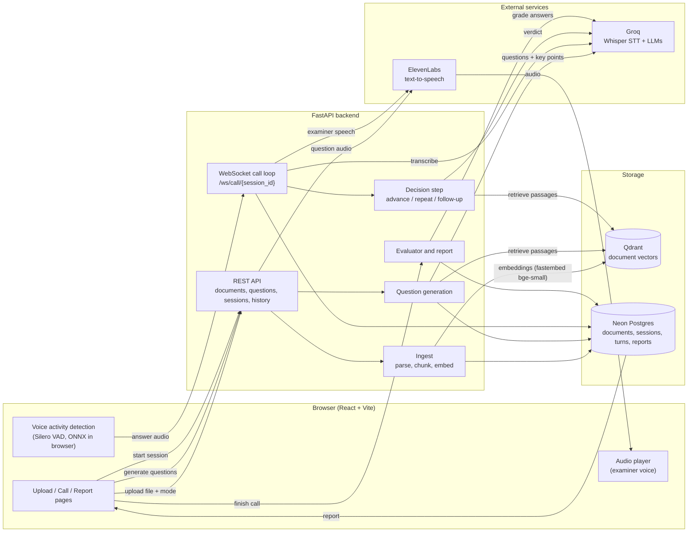

# ViVa Prep

A live AI examiner that helps you prepare for a **viva** (thesis or project defence) or a **job interview** using your own documents. Upload a document, start a spoken session, answer out loud, and get a readiness report.

## What is it?

ViVa Prep turns your own document into a realistic spoken practice session:

1. You upload a PDF or Word file and choose a mode: **Viva** (thesis, dissertation, project report) or **Interview** (resume, job description, project notes).
2. The app reads the document and prepares 3 questions based on it. The questions stay hidden until the examiner asks them, as in the real thing.
3. You speak your answers. The examiner listens, and may ask one follow-up if an answer is vague.
4. At the end you get a readiness report with a score per answer, gaps to fix, and a model answer for each question, all grounded in your document.

## Problem Statement

- Students and job seekers rarely get a chance to practise **speaking** answers about their own work before a viva or an interview. Reading notes is not the same as explaining under pressure.
- Human mock examiners are hard to find, expensive, or only available once.
- Generic AI chatbots and question banks ask generic questions. They do not know your report or resume, so they cannot test whether you can defend what you actually wrote.
- Feedback is usually vague ("be more confident") and not tied to specific points in your own material.

## Proposed Solution

A voice-first practice tool that is grounded in the candidate's own document:

- **Grounded questions.** The document is split into chunks and indexed in a vector database. Questions are generated from retrieved passages, each with the key points a good answer should cover, so every question can be answered from the document.
- **A real spoken conversation.** Voice activity detection runs in the browser. Speech is transcribed, a decision step chooses whether to move on, repeat, or ask one follow-up, and the examiner replies with synthesized speech.
- **Two modes.** Viva and Interview use different examiner prompts, question styles and grading rubrics. Interview mode, for example, rewards concrete examples and measurable results.
- **Honest feedback.** After the call each answer is graded on accuracy, completeness, clarity and justification, using only the retrieved passages as evidence. The report shows scores, missed key points and a model answer.

## Architecture Diagram



### Request flow in short

1. **Upload:** the file and chosen mode go to the backend, which parses the text, chunks it, embeds it and stores the vectors in Qdrant and the metadata in Postgres.
2. **Questions:** the backend retrieves passages for several topics and asks an LLM for 3 questions with key points. The frontend only keeps their ids and shows a "Your questions are ready" screen.
3. **Call:** the browser detects when you stop speaking and sends the audio over a WebSocket. The backend transcribes it, decides what to do next and streams back the examiner's voice.
4. **Report:** when the call ends, each answer is graded against the retrieved passages and a summary is generated.

## Tech stack

| Layer | Technology |
| --- | --- |
| Frontend | React, TypeScript, Vite, in-browser voice activity detection |
| Backend | Python, FastAPI, WebSockets, SQLAlchemy (async) |
| Speech to text | Groq Whisper (`whisper-large-v3-turbo`) |
| Language models | Groq-hosted models for questions, decisions and reports |
| Text to speech | ElevenLabs (`eleven_flash_v2_5`) |
| Embeddings | fastembed `BAAI/bge-small-en-v1.5` (384 dimensions) |
| Vector database | Qdrant (in-memory for local dev, Qdrant Cloud for production) |
| Relational database | Neon Postgres (SQLite for local dev) |

## Run locally

**Backend** (Python 3.11+)
```bash
cd backend
python -m venv .venv && source .venv/bin/activate    # Windows: .venv\Scripts\activate
pip install -r requirements.txt
cp .env.example .env        # fill GROQ_API_KEY, ELEVENLABS_API_KEY, ELEVENLABS_VOICE_ID
uvicorn app.main:app --reload --port 8000
```
Leave `DATABASE_URL` and `QDRANT_URL` empty for a zero-setup dev run (SQLite + in-memory Qdrant). For production paste your Neon string (`postgresql://...?sslmode=require` works as-is) and your Qdrant Cloud URL and key. Tables are created on startup, and new columns are added to existing tables automatically.

Use a database that this app owns. Pointing `DATABASE_URL` at a database that already has a `users` table from another project will fail.

**Frontend**
```bash
cd frontend
npm install
cp .env.example .env        # VITE_API_URL / VITE_WS_URL
npm run dev                 # http://localhost:5173
```

**One-time: static audio clips**
```bash
cd backend && python -m scripts.make_static_audio   # writes frontend/public/audio/*.mp3
```
Without them the app still works: the browser's built-in voice is used for the greeting and closing.

The first upload downloads the embedding model (about 70 MB) from Hugging Face. If you hit a rate limit, set `HF_TOKEN` to a free Hugging Face read token and try again.

## Smoke tests
```bash
python -m scripts.smoke_stt answer.wav   # WAV -> Whisper
python -m scripts.smoke_stt --tts        # ElevenLabs mp3 + streamed PCM
python -m scripts.smoke_stt --qdrant     # insert + filtered search
```

## Tests
```bash
cd backend && pytest
```
Unit tests plus an end-to-end test (upload, questions, session, WebSocket call with follow-up, repeat and resume, report, delete) using mocked Groq and ElevenLabs. A second test covers interview mode.

## Deploy
- **Backend:** any WebSocket-capable host that doesn't sleep (Railway, Render). Use the `Dockerfile`. Set all variables from `.env.example`. `ALLOWED_ORIGINS` must include the frontend URL.
- **Frontend:** Vercel (`vercel.json` handles SPA routing). Set `VITE_API_URL` (https) and `VITE_WS_URL` (wss). The microphone needs HTTPS.

## Things to verify on your accounts
- `MODEL_REPORT=qwen/qwen3.8-27b` is the name used in `SPEC.md`. Change it in `.env` if Groq lists a different id. The client falls back to plain JSON mode if a model rejects strict schemas or `reasoning_effort`.
- ElevenLabs `pcm_24000` output may not be allowed on your plan. The server falls back to `pcm_22050`, then `pcm_16000`, then mp3. Free plans can only use the default (premade) voices through the API.
- Tune thresholds in `backend/app/config.py` and `frontend/src/lib/settings.ts`. `SILENCE_END_MS` controls how long a pause ends your answer.

## Notes
- Generated questions are stored as accepted and are not shown to the user before the call.
- Extra endpoints: `GET /api/documents/{id}/questions` and `GET /api/metrics` (average stage timings).
- Extra optional WebSocket message `speech_start`, so the "repeat?" nudge never fires while the student is talking.

See `SPEC.md` for the full specification.
